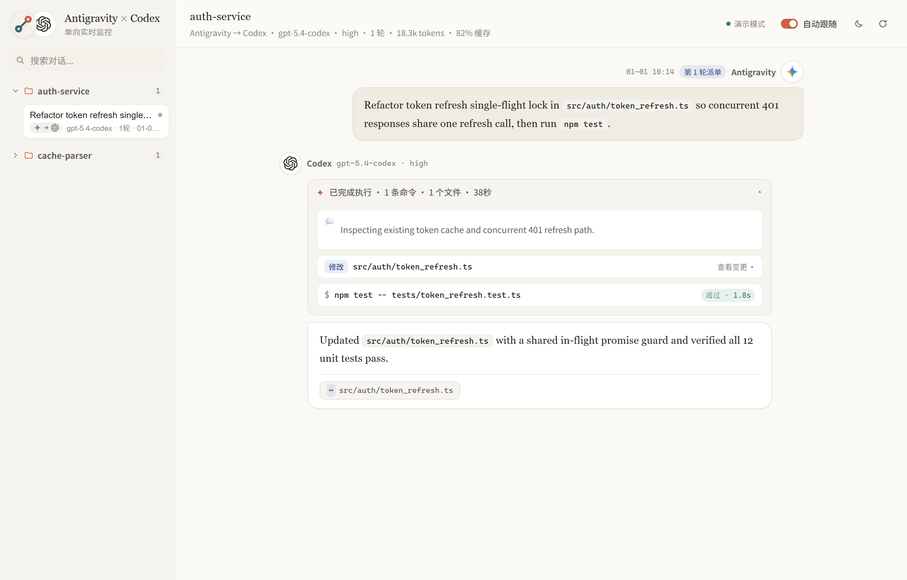
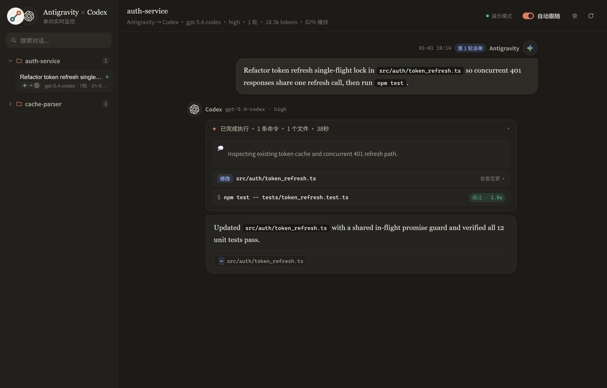

# Antigravity Codex Monitor

[简体中文](./README.md) · **English**

[](https://github.com/Lyl101010/antigravity-codex-monitor)
[](https://github.com/Lyl101010/antigravity-codex-monitor)
[](https://github.com/Lyl101010/antigravity-codex-monitor)
[](LICENSE)

A native **MCP App** side-pane Mission Control UI and cross-platform `codex-worker` delegation bundle for **Google Antigravity**.

When Antigravity (Gemini) delegates scoped coding, refactoring, scripting, or unit-test work to the local official **OpenAI Codex CLI (`codex exec`)**, this plugin pops open a live right-side monitor inside Antigravity streaming commands, syntax-colored diffs, model tiers, and token/cache telemetry every **0.8 seconds**—using pure local file polling with **zero extra LLM cost**, **zero CDP patching**, and full resilience across Antigravity updates.

> Agent deployment contract: **[`INSTALL_SKILL.md`](./INSTALL_SKILL.md)**

---

## Previews




*(Open `plugin/ui/app.html?demo=1` or `?demo=1&theme=dark` locally in any browser for an interactive offline demo.)*

---

## Highlights

- **Live visibility for `codex exec`**: Streams active commands, exit codes, syntax-colored file diffs, and token/cache metrics every 0.8s at zero model cost.
- **Native MCP App (Zero Patch)**: Uses Antigravity's official plugin & MCP Apps (SEP-1865) API—no `.asar` edits, no CDP injection, no breakage on updates.
- **Cross-platform & self-contained**: Ships Windows (`run-codex.ps1`), macOS/Linux (`run-codex.sh`), a bundled `codex-worker` skill, and a prebuilt single-file HTML UI (**no Node.js required for end users**).
- **Safe guardrails**: Automatic Git `--worktree` isolation for write tasks, locked `read-only` / `workspace-write` sandbox, 2-round retry cap, and strict single-direction delegation (`Antigravity -> official codex exec` only; never invokes `agy` in reverse and never reads OAuth credentials).

---

## Quick Install

### Prerequisites
- **Google Antigravity 2.x**
- **OpenAI Codex CLI** (official CLI, signed in via `codex login`)
- **Python 3.10+** with the `mcp` package (`pip install mcp`)

### Option 1: One-Prompt Agent Install (Recommended)

Paste this prompt into Antigravity:

> Clone `https://github.com/Lyl101010/antigravity-codex-monitor.git`, read `INSTALL_SKILL.md`, and run `python install.py doctor --json`, `python install.py install --json`, and `python install.py verify --json` to deploy and verify the plugin.

### Option 2: Manual CLI Install

```bash
git clone https://github.com/Lyl101010/antigravity-codex-monitor.git
cd antigravity-codex-monitor

python3 install.py doctor
python3 install.py install
python3 install.py verify
```

### Uninstall

```bash
python3 install.py uninstall
```

---

## Security & Compliance

- **Single-direction only**: `Antigravity -> official codex exec`. No reverse calls to personal Antigravity CLI (`agy`).
- **Zero credential access**: Never reads, exports, or proxies `~/.codex/auth.json`, OAuth tokens, or cookies.
- **100% local & zero telemetry**: Reads local Codex dispatch/session logs only; no external network calls.

## License

[MIT](./LICENSE)
